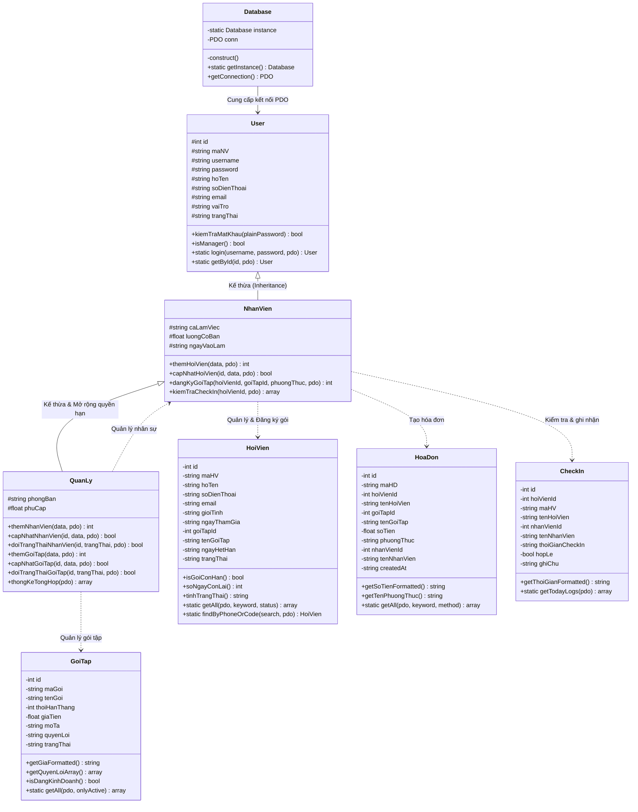

# THIẾT KẾ SƯỜN CODE HƯỚNG ĐỐI TƯỢNG (OOP TRONG PHP) - QUẢN LÝ PHÒNG GYM

Tài liệu này cung cấp thiết kế kiến trúc Lập trình Hướng đối tượng (Object-Oriented Programming - OOP) viết bằng **ngôn ngữ PHP**, kết nối với **Cơ sở dữ liệu MySQL trên XAMPP**, phục vụ 2 tác nhân chính: **Nhân viên (Staff)** và **Quản lý (Manager)**.

---

## 1. SƠ ĐỒ LỚP ĐỐI TƯỢNG (CLASS DIAGRAM)

---

## 2. NGUYÊN TẮC OOP VÀ KIẾN TRÚC ÁP DỤNG TRONG PHP

### 2.1. Tính kế thừa (Inheritance)
- `User` là lớp cơ sở quản lý định danh người dùng hệ thống (`id`, `username`, `password`, `ho_ten`, `vai_tro`).
- `NhanVien extends User`: Kế thừa thuộc tính đăng nhập, bổ sung các nghiệp vụ thường trực tại quầy lễ tân:
  - Thêm, sửa, tìm kiếm hội viên (`themHoiVien`, `capNhatHoiVien`).
  - Điểm danh và kiểm tra hạn sử dụng thẻ (`kiemTraCheckIn`).
  - Đăng ký và gia hạn gói tập, xuất hóa đơn thu tiền (`dangKyGoiTap`).
- `QuanLy extends NhanVien`: Trong phòng gym, Quản lý có thể thực hiện mọi thao tác của Nhân viên, đồng thời được mở rộng thêm các thẩm quyền cấp cao:
  - Quản lý nhân sự (`themNhanVien`, `capNhatNhanVien`, `doiTrangThaiNhanVien`).
  - Quản lý danh mục gói tập (`themGoiTap`, `capNhatGoiTap`, `doiTrangThaiGoiTap`).
  - Báo cáo doanh thu và dòng tiền (`thongKeTongHop`).

### 2.2. Tính đóng gói (Encapsulation)
- Các trường dữ liệu nhạy cảm được đặt ở phạm vi `protected` hoặc `private`.
- Mọi logic nghiệp vụ (ví dụ: tự động tính toán ngày hết hạn, kiểm tra thẻ còn hạn hay không, định dạng chuỗi tiền tệ `number_format`) đều được đóng gói gọn trong Class tương ứng (`HoiVien`, `GoiTap`, `HoaDon`).

### 2.3. Mẫu thiết kế Singleton cho Database XAMPP
- Lớp `Database` trong [config/database.php](file:///d:/Code/Project%20x%C3%A0m%20lol/web%20qu%E1%BA%A3n%20l%C3%BD%20ph%C3%B2ng%20gym/config/database.php) áp dụng mẫu Singleton, bảo đảm toàn bộ hệ thống chỉ duy trì 1 kết nối PDO duy nhất đến MySQL, tiết kiệm tài nguyên và bảo đảm an toàn dữ liệu.

---

## 3. MAPPING CƠ SỞ DỮ LIỆU TRÊN XAMPP (MYSQL)

| Lớp OOP PHP | Bảng MySQL tương ứng | Khóa chính | Khóa ngoại |
|-------------|---------------------|------------|------------|
| `User`, `NhanVien`, `QuanLy` | `users` | `id` | - |
| `HoiVien` | `hoi_vien` | `id` | `goi_tap_id` -> `goi_tap(id)` |
| `GoiTap` | `goi_tap` | `id` | - |
| `HoaDon` | `hoa_don` | `id` | `hoi_vien_id`, `goi_tap_id`, `nhan_vien_id` |
| `CheckIn` | `check_in` | `id` | `hoi_vien_id`, `nhan_vien_id` |
